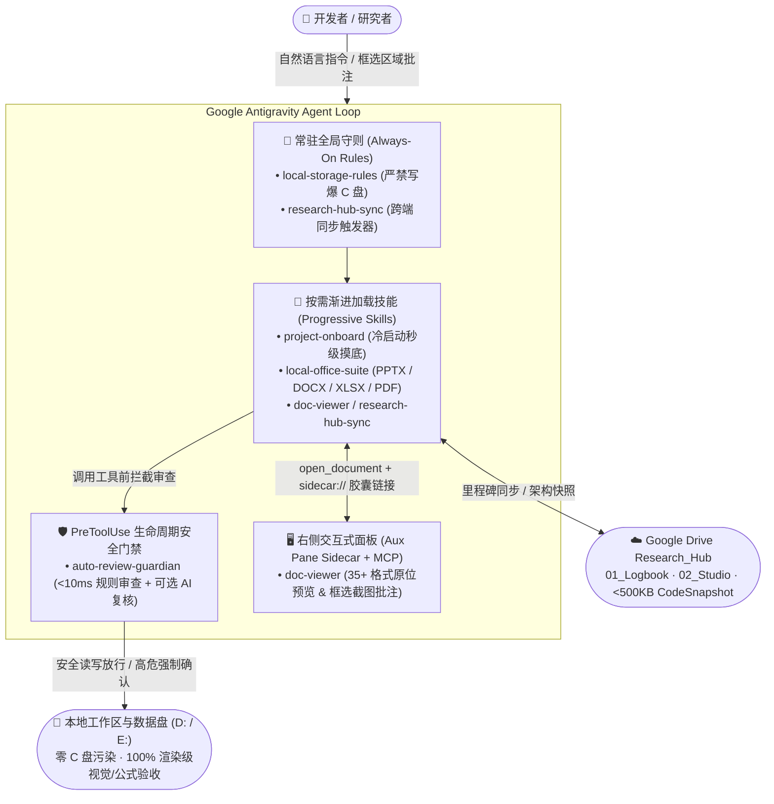

# AntiGravity-Skills 🚀

**中文教程** | [**English Guide (`README_EN.md`)**](./README_EN.md)

一套面向 **Google Antigravity**（同时兼容 **Codex CLI / Desktop** 与 **Claude Code** 技能标准）深度打磨的自研 **Skill Plugins 实战全家桶**。

本仓库不是零散的 Prompt 收集帖，而是将 **侧边栏交互式预览面板（Sidecar + MCP）、本地高质量 Office 四件套生产与视觉质检闭环、毫秒级 `PreToolUse` 安全守卫、亚秒级零改动复杂项目冷启动接手，以及多智能体跨端云同步协议** 封装为即装即用、可独立开关的标准 Antigravity 插件包（`plugins/<name>/plugin.json`）。

---

## 🧭 架构全景：六大插件如何协同工作？



---

## 📦 插件全家桶一览（6 Plugins · 9 Bundled Skills/Rules/Hooks）

| 插件目录 (`plugins/`) | 插件类型 | 一句话核心价值 | 详细文档 |
| :--- | :--- | :--- | :--- |
| [**`doc-viewer`**](./plugins/doc-viewer/README.md) | `Sidecar UI` + `MCP` + `Skill` | 在 Antigravity 右侧面板原位预览 **DOCX、PDF、XLSX/CSV、PPTX、EPUB、Jupyter、SQLite、ZIP** 等 35+ 种文件，支持**框选区域截图向 Agent 批量提修改意见** | [查看详情](./plugins/doc-viewer/README.md) |
| [**`local-office-suite`**](./plugins/local-office-suite/README.md) | `4× Skills` + `35+ 脚本` | 本地专业办公套件：**`pptx`**（PptxGenJS + ISO XSD 校验 + PowerPoint COM 溢出自检）、**`docx-documents`**（修订留痕 `<w:ins>`/`<w:del>` + 批注 + 逐页渲染验版）、**`office-modeling-and-style`**（动态公式建模 + 真 Excel COM 重算排错 + Anti-Slop 写作规范）、**`pdf-workflows`**（交互式 AcroForm 修复填写 + Poppler 视觉质检） | [查看详情](./plugins/local-office-suite/README.md) |
| [**`auto-review-guardian`**](./plugins/auto-review-guardian/README.md) | `PreToolUse Hook` | 仿 Codex `auto_review` 的毫秒级安全守卫：只读命令、`--help`、工作区内读写**静默秒放行**；格盘、强推代码、发正式邮件、删库分享、读 `.env/.ssh` 或篡改守卫自身**100% 强制弹窗确认** | [查看详情](./plugins/auto-review-guardian/README.md) |
| [**`project-onboard`**](./plugins/project-onboard/README.md) | `Skill` + `Scout Script` | 复杂项目冷启动接手神器：先跑亚秒级零改动探针 `scout_project.py`（自动预警 30 分钟内并发热文件与过时 README），按四层真相金字塔精读后输出一屏《项目接手与最新任务对账单》 | [查看详情](./plugins/project-onboard/README.md) |
| [**`research-hub-sync`**](./plugins/research-hub-sync/README.md) | `Rule` + `Skill` + `Bundler` | 打通 Antigravity / Codex / ChatGPT / Gemini 的三方云同步协议：统一维护云端 `01_Logbook`、`02_Studio` 看板，并用 AST 感知的 `pack_codesnapshot.py` 一键生成 `<500 KB` 单文件代码快照 | [查看详情](./plugins/research-hub-sync/README.md) |
| [**`local-storage-rules`**](./plugins/local-storage-rules/README.md) | `Global Rule` | 专为系统盘容量有限的多盘工作站设计：强制所有工作文件、临时 Scratch 脚本、渲染中间图与 CLI 缓存落盘至数据盘（`D:` / `E:`），彻底根治 AI Agent 塞满 `C:` 盘 | [查看详情](./plugins/local-storage-rules/README.md) |

---

## ⚡ 三分钟快速安装教程（支持 3 种安装方式）

先把仓库克隆到本地任意目录（Windows 多盘用户建议克隆到 `D:` 或 `E:` 盘）：

```bash
git clone git@github.com:lenfgh/AntiGravity-Skills.git
cd AntiGravity-Skills
```

### 方式一：一键脚本安装（最推荐 · 支持软链接实时热更新）

我们提供了开箱即用的跨平台安装器，支持**全量安装**、**按需挑选插件**、**免管理员权限的目录联接（Junction / Symlink，后续 `git pull` 即刻生效）**，并会自动为 `doc-viewer` 安装前端解析依赖：

**Windows PowerShell：**
```powershell
# 1. 查看所有可用插件列表
powershell -ExecutionPolicy Bypass -File .\install.ps1 -List

# 2. 一键安装全部 6 个插件（复制模式）
powershell -ExecutionPolicy Bypass -File .\install.ps1 -All

# 3. 进阶推荐：用 NTFS Junction 软链接模式安装全部插件（无需管理员权限，git pull 自动同步最新更新！）
powershell -ExecutionPolicy Bypass -File .\install.ps1 -All -Link

# 4. 只安装你需要的指定插件（逗号分隔）
powershell -ExecutionPolicy Bypass -File .\install.ps1 -Plugin doc-viewer,local-office-suite,project-onboard

# 5. 同时把所有内部 SKILL.md 同步导出到 ~/.codex/skills 供 Codex CLI/Desktop 使用
powershell -ExecutionPolicy Bypass -File .\install.ps1 -All -CodexSkills
```

**macOS / Linux：**
```bash
# 安装全部插件（使用 --link 创建软链接）
bash ./install.sh --all --link

# 按需安装指定插件
bash ./install.sh --plugin doc-viewer,project-onboard
```

---

### 方式二：零拷贝声明式挂载（原生 `plugins.json` 机制）

Antigravity 原生支持通过 `plugins.json` 直接引用外部插件仓库目录，无需复制任何文件，且支持 `include_only` / `exclude` 精细过滤：

- **个人本机全局生效**：编辑（或新建）`~/.gemini/config/plugins.json`
- **项目团队共享生效**：编辑（或新建）项目根目录 `.agents/plugins.json`

写入以下内容（将路径替换为你克隆本仓库的实际路径）：

```json
{
  "entries": [
    {
      "path": "E:/Project/AntiGravity-Skills/plugins",
      "exclude": []
    }
  ]
}
```
> **注意**：若使用方式二启用了 `doc-viewer`，请首次进入 `plugins/doc-viewer/sidecars/doc_viewer` 执行一次 `npm install`。

---

### 方式三：手动挑选单个插件或单个 Skill

1. **作为 Antigravity 插件安装**：将 `plugins/<插件名>` 文件夹直接复制到 `~/.gemini/config/plugins/<插件名>`。安装后无需重启 IDE，在下一轮对话即自动生效；你也可以在 Antigravity 的 **Settings → Customizations → Plugins** 页面随时独立开关任一插件。
2. **在 Codex / Claude Code 中单独复用 Skill**：将任意 `plugins/<插件名>/skills/<技能名>` 目录复制到 `~/.codex/skills/` 或 `~/.claude/skills/` 即可无缝复用。

---

## 🎓 保姆级实战使用指南（逐个插件怎么用？）

### 1️⃣ `doc-viewer`：在 IDE 右侧面板直接看文档 & 框选提修改意见

- **前置条件**：Node.js 18+（运行 `install.ps1` / `install.sh` 时会自动在 `sidecars/doc_viewer` 下执行 `npm install`）。
- **怎么触发？** 直接对 Agent 说：
  - `“在侧边栏打开当前工作区里的 report.docx”`
  - `“用 Document Viewer 预览 results/metrics.xlsx”`
  - `“把刚生成的 slides.pptx 在侧边栏打开给我检查”`
- **交互技巧**：
  1. Agent 会自动调用 `open_document` MCP 工具，并在聊天框给出一个一键胶囊按钮 **`[预览 report.docx](sidecar://doc-viewer/doc_viewer/)`**，点击即可展开右侧预览栏。
  2. **DOCX 双视图切换**：顶部工具栏可在 `Layout`（真实分页版式）与 `Reader`（清爽重排阅读）之间一键切换。
  3. **框选区域精准返工**：在预览画面上按住鼠标框选某张跑偏的表格或某段文字，输入修改要求发送，Agent 会同时收到你的文字指令和该区域的 `PNG` 选区截图，指哪改哪！

---

### 2️⃣ `local-office-suite`：生成经得起视觉与公式审计的专业 Office 文档

普通大模型写 Office 文档最大的毛病是“只管生成代码、不看实际长相”，导致文字溢出文本框、表格列宽挤压成一团、Excel 写死静态数字甚至藏着 `#REF!` 报错。本插件用 **4 个专业子技能 + 强制视觉/公式闭环验收** 彻底解决这个问题：

#### 前置环境一键配齐
```bash
# Python 核心文档与渲染库
pip install python-docx python-pptx openpyxl xlsxwriter reportlab pypdf pdfplumber pdf2image Pillow lxml

# Node.js 幻灯片与高清 Lucide 图标生成库
npm install -g pptxgenjs sharp lucide
```
*(再配合跨平台 **Poppler (`pdftoppm`)** + **LibreOffice** 或 Windows 原生 **Microsoft Office** 即可解锁 100% 字体保真渲染自检)*

#### 四大场景直接抄作业的 Prompt：
- **做高颜值结构化 PPTX（`pptx` skill）**：
  > `“阅读 docs/summary.md，用 pptx skill 生成一份 8 页项目汇报 deck.pptx：先定义深蓝学术配色主题和母版，包含原生柱状对比图与 Lucide 图标卡片；生成后必须跑 validate.py 做 OOXML XSD 校验，并导出页面图片逐页检查没有文字溢出。”`
- **写 Word 或做非破坏性修订批注（`docx-documents` skill）**：
  > `“不要直接覆盖原文，请用 docx-documents 的修订留痕脚本（Tracked Changes）润色 paper_draft.docx 的摘要部分，在修改处附上批注说明理由，并用 render_docx.py 渲染成图片检查排版。”`
- **搭动态公式 Excel 模型并强制真重算审计（`office-modeling-and-style` skill）**：
  > `“按 Outputs -> Assumptions -> Builds -> Inputs -> Checks 标签架构新建一份营收测算模型 model.xlsx，所有汇总与敏感度分析必须使用动态 Excel 公式并规范 $ 锚定，最后调用 audit_xlsx_excel_com.ps1 强制 Excel 重算确认 0 公式报错。”`
- **填写或修复交互式 PDF 表单（`pdf-workflows` skill）**：
  > `“检查 registration.pdf 的表单域结构，填入参会人信息并保持交互式可编辑状态（不要压平），完成后重开核验字段值并用 render_pdf_pages.py 渲染确认无截断。”`

---

### 3️⃣ `auto-review-guardian`：放心开自动执行（Turbo），高危动作稳稳拦住

开启 Agent 自动运行命令很爽，但谁也不想看到 Agent 一时手滑执行 `git reset --hard`、删掉非临时源码目录、误发未审阅的正式邮件或改动系统盘配置。

- **工作原理**：每次 Agent 准备执行 `run_command`、写文件或调 MCP 工具前，`hooks.json` 会调用纯 Python 标准库编写的 `antigravity_guardian.py`（耗时 `< 10 ms`）：
  - **无感秒放行 (`allow`)**：`git status/diff/log`、`rg/ls/Get-ChildItem`、所有 `--help`、当前打开工作区内的文件读写、安全的 `_tmp` / `_work` 渲染目录清理、`gmail mutate create-draft`（存草稿）。
  - **强制人工确认 (`force_ask`)**：工作区外的陌生路径写入、非临时目录递归删除（`rm -rf` / `Remove-Item -Recurse` / `shutil.rmtree`）、`git push --force`、`gmail mutate send`（真发邮件）、`gdrive/gdocs delete|share`、访问 `.env` / `.ssh` / `.aws` 凭据，以及任何试图修改 `hooks.json` / `config.json` / 守卫脚本自身的行为。
  - **直接硬拒绝 (`deny`)**：`format` 磁盘、`diskpart`、`bcdedit`、`Stop-Computer` 等系统级破坏指令。
- **自定义你的白名单**：打开 [`plugins/auto-review-guardian/scripts/guardian_policy.json`](./plugins/auto-review-guardian/scripts/guardian_policy.json)，按你的习惯调整 `allowed_write_roots`，然后跑一遍内置的 13 项单元测试即可验证无误：
  ```bash
  python -B -m unittest discover -s plugins/auto-review-guardian/scripts -p "test_*.py" -v
  ```

---

### 4️⃣ `project-onboard`：5 秒接手陌生/复杂项目，拒绝瞎猜与误踩并发现场

每次新开一个会话接手复杂项目时，直接输入一句口令：
- **`“接手这个项目”`** / **`“摸底当前项目并聚焦最新任务”`** / **`“盘点当前战线”`**

Agent 会自动按四步标准动作执行：
1. **跑亚秒级只读探针**：运行 `scripts/scout_project.py --path "<当前工作区>"`（绝不扫 `.venv` / 权重包，绝不算全量哈希）。
2. **并发与陈旧文档排雷**：若过去 30 分钟内有后台训练或其他终端正在改文件，自动触发 `[LIVE_ACTIVITY_ALERT]` 严禁覆盖；若 `README.md` 落后于最新实验回执，触发 `[STALE_README_WARNING]` 防止采信过时数字。
3. **四层真相金字塔精读**：控制在 5–8 个关键文件内（`L1 治理红线` → `L2 最新机器回执` → `L3 云端看板` → `L4 架构入口`）。
4. **首轮严格只读，输出一屏《项目接手与最新任务对账单》**：清晰列出核心目标、当前唯一有效基线（含历史作废口径提醒）、活跃战线表格、环境边界，以及按紧迫度排序的下一步行动建议。

---

### 5️⃣ `research-hub-sync`：多智能体跨端协同不丢上下文

如果你习惯**在网页端用 ChatGPT Pro / Gemini 做长文架构推演与论文构思，在本地用 Antigravity / Codex 写代码跑实验**，这套插件能帮你建立零摩擦接力流：

1. **三分钟初始化绑定**：
   - 在 Google Drive 创建项目文件夹及两个固定 Google Docs（`01_Logbook` 实验台账 + `02_Studio` 当前方案看板）。
   - 参考 [`plugins/research-hub-sync/examples/REGISTRY.example.md`](./plugins/research-hub-sync/examples/REGISTRY.example.md) 将 Doc ID 记入本地 `REGISTRY.md` 或项目 `AGENTS.md`。
2. **日常三大高频工作流**：
   - **开工对齐**：对本地 Agent 说 **`“继续当前方案”`** —— Agent 会自动先读云端 `02_Studio` 顶部看板，第一行报出当前看板版本号（如 `v20261119-2`），严格在获准范围内施工。
   - **里程碑留档**：跑出新有效结果或定位了关键失败根因后，说 **`“同步云端”`** —— Agent 自动按倒序标准模板将实验配置、精确分母与指标写入 `01_Logbook`。
   - **打包 `<500 KB` 架构快照给网页大模型做 Code Review**：
     ```bash
     python plugins/research-hub-sync/scripts/pack_codesnapshot.py \
       --project MyProject --root /path/to/repo --focus src/core src/cli tests
     ```
     生成的 `MyProject_03_CodeSnapshot.md` 包含紧凑目录树 + 核心源码 + 超预算文件自动提取的 Python AST 类与函数签名，直接拖进网页端对话框即可获得零幻觉的深度架构评审！

---

### 6️⃣ `local-storage-rules`：守住 Windows `C:` 盘剩余空间

装上即生效的轻量常驻规则插件（`rules/AGENTS.md`）：
- 强制 Agent 将所有项目产物、临时测试脚本、PDF/PPT 视觉验收图片落盘到 `E:` 或 `D:` 盘工作区的 `_tmp/` 目录（不再往 `C:\Users\<User>\.gemini\...\scratch\` 堆垃圾）。
- 若你的数据盘符不同（如只有 `D:` 盘或挂载在 `/mnt/data`），直接修改 [`plugins/local-storage-rules/rules/AGENTS.md`](./plugins/local-storage-rules/rules/AGENTS.md) 中的盘符字母即可。

---

## 🛠️ 如何参考本仓库开发你自己的 Antigravity 插件？

每个标准插件只需在 `plugins/<your-plugin-name>/` 下遵循以下极简目录约定：

```text
plugins/<your-plugin-name>/
├── plugin.json               # 必填：插件清单（name 必须全局唯一且使用 kebab-case）
├── README.md                 # 推荐：面向人类读者的说明文档（不会占用 Agent 上下文）
├── assets/logo.svg           # 推荐：1:1 方形图标（保留约 10% 边距，支持深浅主题）
├── rules/AGENTS.md           # 可选：启用插件期间始终生效的常驻规则（无 YAML 头）
├── hooks.json                # 可选：生命周期钩子（必须放在插件根目录！）
├── mcp_config.json           # 可选：随插件启停的 MCP Server 配置
├── sidecars/<name>/          # 可选：右侧辅助面板 Web UI Sidecar
└── skills/<skill-name>/      # 可选：按需渐进加载的专业技能
    ├── SKILL.md              # 必填：含 name 与 description YAML 头的操作手册
    └── scripts/              # 可选：配套确定性工具脚本
```

> **开发避坑小贴士**：
> 1. **渐进式披露省 Token**：常驻硬红线放 `rules/AGENTS.md`（保持精悍），长篇多步流程放 `skills/<name>/SKILL.md`（平时只注入一句话 `description`，命中任务时才按需读取全文）。
> 2. **`hooks.json` 位置与相对路径**：原生插件的 `hooks.json` 必须直接放在插件根目录，且运行时工作目录即为该插件根目录，因此命令直接写 `"python -X utf8 scripts/your_hook.py"` 即可跨机器移植。
> 3. **`logo` 路径规范**：`plugin.json` 中的 `logo` 请使用相对路径（如 `"assets/logo.svg"`），不要填外部 URL 或绝对路径。

---

## 📄 开源协议 (License)

本仓库采用 [MIT License](./LICENSE) 开源（部分 Office OOXML Schema 与校验组件保留其上游开源许可声明，详见对应子目录 `LICENSE.txt`）。欢迎 Fork、提 Issue 或提交你自己的高价值 Antigravity Skill Plugin！
